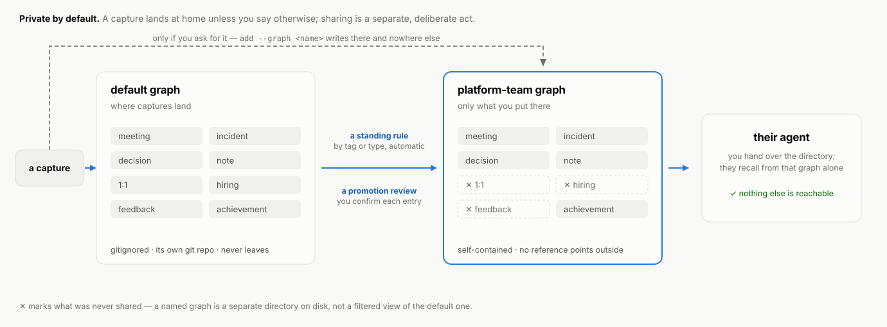
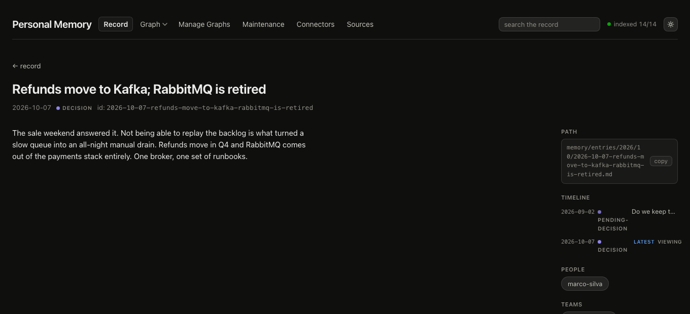
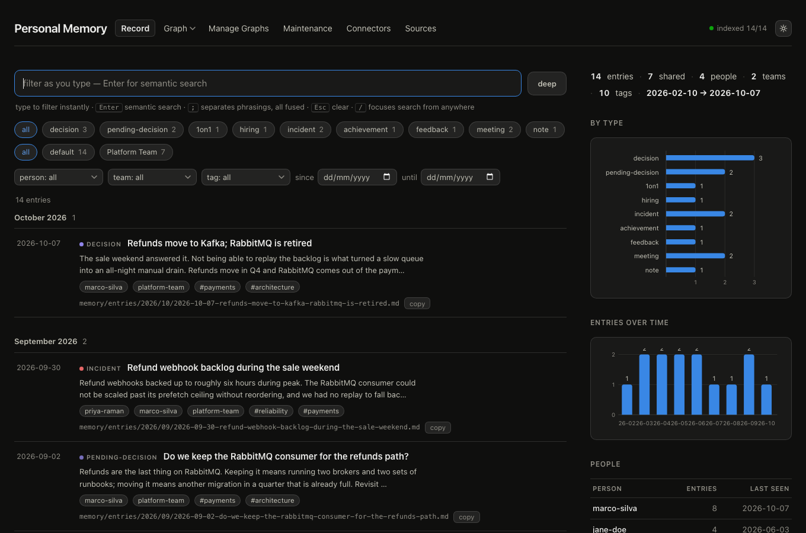

<p align="center">
  
</p>

<h1 align="center">Personal Memory</h1>

<p align="center">
  <strong>Local-first memory for your working life.</strong><br>
  Private by default, shareable on purpose.
</p>

<p align="center">
  <a href="LICENSE"></a>
  
  
</p>

---

Six months of work produces context that never fits in chat history: who said
what in a 1:1, why a decision went the way it did, what the last incident
actually taught you, which hiring thread is still open.

Personal Memory keeps that record on your own disk as Markdown, and gives your
coding agent a grounded way to write to it and recall from it. There is no SDK
to integrate and no service to sign up for — you talk to the agent you already
have open.

<p align="center">
  
</p>

Look at the second result. The question *"Kafka or RabbitMQ?"* was settled in
April, and recall says so — `⤷ superseded by`, `status: resolved by` — instead
of handing back a seven-month-old snapshot as if it were current.

## Private by default

Your working record is the most sensitive material you would ever give an AI.
So none of it leaves:

- Every capture lands in `memory/`, ignored by this repository and versioned in
  its own local git repo. `git pull` on the project cannot touch an entry.
- Embeddings run on your machine (`Xenova/bge-small-en-v1.5`). No API backend is
  used unless you deliberately set `MEMORY_EMBEDDINGS`.
- The UI binds to `127.0.0.1`.
- `.index/` is derived state and can be deleted and rebuilt at any time.
- No account, no hosted tier, no telemetry, nothing to opt out of.

Don't publish a populated `memory/` directory, or screenshots of one, unless
you have intentionally sanitized them.

## Shareable on purpose

Eventually you want someone to have *part* of the record — a team, a successor,
the person taking over a project. The hard part of sharing memory is not sending
it. It's knowing that what you send doesn't leak what you didn't.

<p align="center">
  <picture>
    <source media="(prefers-color-scheme: dark)" srcset="docs/assets/graph-flow-dark.svg">
    
  </picture>
</p>

A **named graph** is a physically separate directory with its own git repo.
Entries reach one only by your decision: a standing rule for a tag or type, or a
promotion review where you confirm entries one at a time. The 1:1s, the hiring
debriefs and the feedback stay at home unless you say otherwise.

And a shared graph is **self-contained** — an entry in it may only reference
fellow members. That's enforced on write, not left to discipline:

<p align="center">
  
</p>

The decision is refused until its pending-decision comes too, because a dangling
reference out of a shared graph is exactly the kind of leak you cannot see by
reading the files. At the end, asking that graph about a private 1:1 returns
work artifacts and nothing else — the entry simply isn't in there.

You hand the directory over yourself: push its repo, or copy it. There is no
sync service in the middle, which is the point.

## Quick start

Requires Node.js 20 or newer.

```bash
git clone https://github.com/vladimanaev/personal-memory.git
cd personal-memory
npm install
npm run index
npm start
```

`npm start` opens the UI at `http://127.0.0.1:4664`. It will be empty — it's a
record browser, not a welcome wizard. Fill it by opening the folder in your
agent and talking:

```text
"Log this 1:1 with Jane: promotion readiness, scope gaps, a follow-up for Friday."
"Remember that the platform team deferred project alpha until Q4."

"What do I know about Jane's promotion readiness?"
"Is the queue technology decision still open?"
"Help me prep for my next 1:1 with Jane."
```

Full setup, the plugin install that makes this work from *other* repos, and
connector pulls from Gmail and Slack: **[docs/install.md](docs/install.md)**.

## What else is different

**It tells you what's still true.** Entries link into chains — a note becomes a
pending decision becomes a decision — and recall annotates stale members instead
of ranking them like everything else. Open items report whether they were
resolved and by what.

<p align="center">
  
</p>

**The agent is the interface.** No SDK, no client library, no integration code.
Repo-level instructions and skills teach the agent when to capture and when to
recall, and guardrail hooks make the correct path the only path — agents can't
grep the store or hand-write entries, which is what makes recall trustworthy
rather than best-effort.

**Retrieval is hybrid, not just vectors.** Local embeddings, persistent BM25,
reciprocal rank fusion, metadata prefilters, query expansion, and an optional
local cross-encoder rerank.

**There's a UI for reading.** Browse, search, filter by person, team, tag, type
and date, inspect the graph, and edit connector and source config.

<p align="center">
  
</p>

## Documentation

| | |
|---|---|
| [docs/install.md](docs/install.md) | Setup, `memui`, plugin install for other repos, connectors |
| [docs/cli.md](docs/cli.md) | Every command, with the flags that matter |
| [docs/concepts.md](docs/concepts.md) | Storage layout, entry schema, graphs, timeline chains, retrieval |
| [docs/reference-sources.md](docs/reference-sources.md) | Optional directory lookups for slug ground truth |
| [docs/upgrading.md](docs/upgrading.md) | Migration, backup and restore, index slots |
| [AGENTS.md](AGENTS.md) | The agent contract — capture, recall, citations |
| [MEMORY-GUARDRAILS.md](MEMORY-GUARDRAILS.md) | Write-safety rules for `memory/` |

Agent skills live in [`skills/`](skills): capture, recall, single-graph recall,
promotion, graph management, tag compaction, connector pulls, and a morning
brief.

## Contributing

Bug reports, docs fixes, UI polish, retrieval improvements and connector
templates are all welcome. The one rule that shapes everything else: **keep it
local-first** — nothing hosted may become required for normal use.

```bash
npm install
npm run typecheck
npm test
```

Start with [CONTRIBUTING.md](CONTRIBUTING.md) — it covers the architecture, the
privacy review every PR goes through, and a few good first issues.

## Community

- Security reports: [SECURITY.md](SECURITY.md)
- Code of conduct: [CODE_OF_CONDUCT.md](CODE_OF_CONDUCT.md)
- License: [Apache License 2.0](LICENSE)
